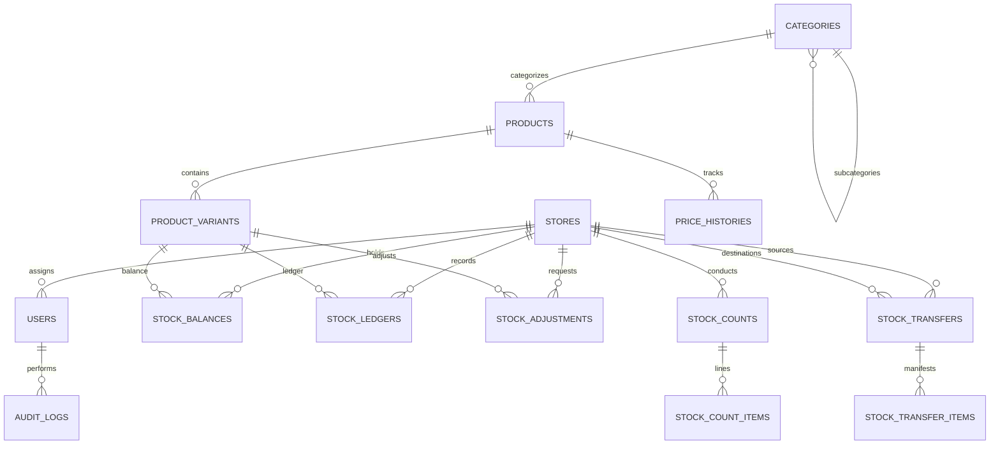

# Clothing Store Management System — Phase 1 Delivery Report
## Master Prompt 1 of 4: Foundation, Database, Access Control & Core Inventory

**Date:** 16-10-2026  
**System:** Multi-store Retail Clothing POS & ERP (Bangladesh Context)  
**Framework:** Laravel 12 (PHP 8.2.12), MySQL/MariaDB, Blade, Tailwind CSS, Alpine.js  
**Commit:** Master branch clean commit `feat: complete Master Prompt 1 - foundation, database, access control, and core inventory`

---

## 1. Repository & Hosting Inspection Summary
- **Environment Discovered:**
  - OS: Windows NT (xampp stack in `D:\xampp`).
  - PHP: 8.2.12 CLI (`D:\xampp\php\php.exe`) with `pdo_mysql`, `mbstring`, `openssl`, `bcmath`, `fileinfo`.
  - Database: MySQL/MariaDB 10.4.32 on `127.0.0.1:3306`.
  - Node / NPM: v22.14.0 / npm 10.9.2.
- **Repository State:**
  - Workspace `d:\xampp\htdocs\pos` was inspected. An initial scaffold was built into a production-grade Modular Monolith structure without extraneous dependencies.
  - Development Database: `clothing_pos` (initialized with migrations & seeders).
  - Test Database: `clothing_pos_test` (isolated MySQL schema ensuring native row locks, transactions, and foreign key validations pass identical to production).

---

## 2. Architecture & Module Structure

The project follows a **Modular Monolith** architecture with thin controllers, centralized service boundaries, database transactions, and strict role/store authorization.

```
d:\xampp\htdocs\pos\
├── app/
│   ├── Enums/
│   │   ├── UserRole.php              # super_admin, store_manager, cashier, warehouse_staff, accountant
│   │   ├── StockAdjustmentStatus.php  # pending, approved, rejected
│   │   └── StockTransactionType.php   # opening_stock, purchase_received, transfer_out/in, adjustment_add/sub...
│   ├── Helpers/
│   │   └── FormattingHelper.php      # BDT currency (৳) & DD-MM-YYYY date formatting
│   ├── Http/
│   │   ├── Controllers/
│   │   │   ├── Auth/AuthenticatedSessionController.php
│   │   │   ├── AuditLogController.php
│   │   │   ├── BarcodeController.php
│   │   │   ├── CategoryController.php
│   │   │   ├── ConnectivityController.php
│   │   │   ├── DashboardController.php
│   │   │   ├── InventoryController.php
│   │   │   ├── ProductController.php
│   │   │   ├── StaffController.php
│   │   │   ├── StockAdjustmentController.php
│   │   │   ├── StockCountController.php
│   │   │   └── StoreController.php
│   │   └── Middleware/
│   │       ├── EnforceStoreScope.php          # Prevents Cross-Store URL tampering
│   │       ├── EnforceUserRole.php           # Least-privilege server-side role gate
│   │       ├── EnsureSingleActiveSession.php # Concurrency session revocation & deactivation lockout
│   │       └── SetAppLocale.php              # Per-user persistent locale ('en', 'bn')
│   ├── Models/                               # 14 Eloquent Models with explicit casts & relationships
│   └── Services/
│       ├── AuditService.php          # Immutable audit logging with credential sanitization
│       ├── BarcodeService.php        # Code 128 permanent generation & SVG rendering
│       ├── InventoryService.php      # Row locking (lockForUpdate), stock ledgers & atomic balances
│       └── SkuGeneratorService.php   # Concurrency-safe sequential SKU generator (e.g. SH-000123)
├── database/
│   ├── migrations/                   # 13 version-controlled relational migrations
│   └── seeders/DatabaseSeeder.php    # Seed central warehouse (WH-001), 6 retail stores, admin/staff, variants
├── lang/
│   ├── bn/messages.php               # Complete Bengali localization
│   └── en/messages.php               # Complete English localization
├── resources/
│   ├── css/app.css                   # Tailwind CSS styling with dark-mode support
│   ├── js/app.js                     # Alpine.js & html5-qrcode camera barcode scanner
│   └── views/                        # Blade templates (Accessible, responsive, print stylesheets)
└── tests/
    └── Feature/                      # 11 comprehensive automated test suites (28 tests, 97 assertions)
```

---

## 3. Database ER & Relational Schema Documentation



### Table Specifications:
1. **`stores`**: `id`, `code` (unique, e.g. `WH-001`, `ST-001`), `name`, `type` (`warehouse`, `retail`), `address`, `phone`, `manager_id`, `opening_time`, `closing_time`, `is_active`.
2. **`users`**: `id`, `name`, `email`, `password`, `role` (`super_admin`, `store_manager`, `cashier`, `warehouse_staff`, `accountant`), `store_id`, `is_active`, `current_session_id`, `locale` (`en`, `bn`), `theme` (`light`, `dark`).
3. **`categories`**: `id`, `name`, `code` (unique, 2-4 uppercase letters, e.g. `SH`, `PT`, `PA`), `parent_id` (self-referential for subcategories), `is_active`.
4. **`products`**: `id`, `name`, `sku` (unique, e.g. `SH-000101`), `category_id`, `subcategory_id`, `brand`, `season`, `fabric`, `purchase_price` (`decimal(12,2)`), `selling_price` (`decimal(12,2)`), `is_active`. *(No photo columns as mandated)*.
5. **`product_variants`**: `id`, `product_id`, `size`, `color`, `barcode` (unique Code 128 string), `additional_purchase_price` (`decimal(12,2)`), `is_active`.  
   - Composite unique constraint: `UNIQUE(product_id, size, color)`.
6. **`price_histories`**: `id`, `product_id`, `old_price`, `new_price`, `reason`, `changed_by`, `created_at`.
7. **`stock_balances`**: `id`, `store_id`, `product_variant_id`, `quantity` (`decimal(12,2)`), `reserved_quantity` (`decimal(12,2)`).  
   - Composite unique constraint: `UNIQUE(store_id, product_variant_id)`.
8. **`stock_ledgers`**: `id`, `transaction_type`, `reference_number`, `source_store_id`, `destination_store_id`, `product_variant_id`, `quantity`, `balance_before`, `balance_after`, `unit_cost`, `user_id`, `notes`, `created_at`. Immutable ledger.
9. **`stock_adjustments`**: `id`, `adjustment_number` (unique), `store_id`, `product_variant_id`, `old_quantity`, `proposed_quantity`, `difference_quantity`, `reason`, `status` (`pending`, `approved`, `rejected`), `requested_by`, `actioned_by`, `actioned_at`.
10. **`stock_counts`** & **`stock_count_items`**: Complete physical stock count auditing headers and lines with discrepancy calculation (`counted_qty - system_qty`).
11. **`stock_transfers`** & **`stock_transfer_items`**: Transfer headers and lines prepared with `draft`, `pending`, `dispatched`, `received`, `cancelled` statuses.
12. **`audit_logs`**: `id`, `user_id`, `event`, `auditable_type`, `auditable_id`, `old_values` (JSON), `new_values` (JSON), `ip_address`, `user_agent`, `reason`, `created_at`.

---

## 4. Implemented Migrations & Core Application Modules

All 13 migrations were executed against MySQL:
- `0001_01_01_000000_create_users_table.php`
- `0001_01_01_000001_create_cache_table.php`
- `0001_01_01_000002_create_jobs_table.php`
- `2026_10_16_000001_create_stores_table.php`
- `2026_10_16_000002_add_store_id_to_users_table.php`
- `2026_10_16_000003_create_categories_table.php`
- `2026_10_16_000004_create_products_table.php`
- `2026_10_16_000005_create_product_variants_table.php`
- `2026_10_16_000006_create_price_histories_table.php`
- `2026_10_16_000007_create_stock_balances_table.php`
- `2026_10_16_000008_create_stock_ledgers_table.php`
- `2026_10_16_000009_create_stock_adjustments_table.php`
- `2026_10_16_000010_create_stock_counts_and_items_tables.php`
- `2026_10_16_000011_create_stock_transfers_and_items_tables.php`
- `2026_10_16_000012_create_audit_logs_table.php`

---

## 5. Authentication, Roles, Permissions & Store Scoping

| Requirement | Implementation Detail | Status |
| :--- | :--- | :--- |
| **5 Roles** | `super_admin`, `store_manager`, `cashier`, `warehouse_staff`, `accountant` | Verified |
| **No Public Registration** | `/register` routes disabled; staff accounts created only by Super Admin | Verified |
| **Password Policy** | Min 8 chars, mixed-case letters, numbers, and special symbols enforced | Verified |
| **Single Active Device Session** | `EnsureSingleActiveSession` checks `current_session_id`; subsequent login revokes prior session | Verified |
| **Immediate Account Deactivation Lockout** | `is_active` checked on every authenticated request; instant logout upon deactivation | Verified |
| **Store Scoping Protection** | `EnforceStoreScope` prevents `store_manager` from accessing other store IDs via URL/parameters | Verified |
| **Audit Logging** | Successful & failed logins logged with IP, user agent; passwords completely redacted | Verified |

---

## 6. Product Catalog, Variant, Barcode & Inventory Foundation

1. **Sequential SKU Generation:**
   - Format: `{CategoryCode}-{Serial6Digits}` (e.g. `SH-000101`, `PT-000102`).
   - Uses row locking (`lockForUpdate`) on existing products within category to prevent race conditions.
2. **Permanent Code 128 Barcodes:**
   - EAN/Code-128 compliant format: `880` (Bangladesh prefix) + 9-digit variant sequence + 1 checksum digit (13 digits total).
   - Once assigned to a `ProductVariant`, the barcode is immutable in database. Reprinting queries the existing variant and never regenerates a new barcode.
3. **Price Management:**
   - Selling price updates are restricted exclusively to `super_admin`.
   - Every price change inserts into `price_histories` with `old_price`, `new_price`, `reason`, `changed_by`.
4. **Inventory & Ledger Integrity:**
   - Dual-entry stock ledger: every balance change has a corresponding immutable `stock_ledgers` entry.
   - Row-level lock (`lockForUpdate`) prevents race conditions and negative inventory (overselling).
   - Stock adjustments require Super Admin approval. Quantities remain unchanged in `stock_balances` until approved.
5. **Hardware & Camera Barcode Scanning:**
   - Integrated camera scanning modal using `html5-qrcode` with support for high-frequency hardware USB/Bluetooth laser scanners.
   - Dedicated Thermal Label Print View with customizable sizes (Standard 50x30mm, 38x25mm, 100x50mm) and high-density SVG barcode rendering.

---

## 7. Automated Tests & Actual Test Results

Executed with PHP 8.2.12 against isolated MySQL test database `clothing_pos_test`:

```
   PASS  Tests\Unit\ExampleTest
  ✓ that true is true

   PASS  Tests\Feature\AuthenticationAndSessionTest
  ✓ successful login assigns session and records audit log
  ✓ failed login records audit log without leaking password
  ✓ single active session enforcement
  ✓ deactivated account is immediately locked out
  ✓ password policy enforcement
  ✓ public registration is not available

   PASS  Tests\Feature\ConcurrentStockOversellingTest
  ✓ overselling is blocked when insufficient stock available

   PASS  Tests\Feature\ConnectivitySafeguardTest
  ✓ active connection heartbeat returns online status
  ✓ connectivity loss stops business operations safely

   PASS  Tests\Feature\ExampleTest
  ✓ unauthenticated user is redirected to login
  ✓ authenticated user can view dashboard

   PASS  Tests\Feature\LocalizationAndWorkflowTest
  ✓ language switcher persists in user profile and session
  ✓ bdt currency and date formatting

   PASS  Tests\Feature\ProductAndVariantValidationTest
  ✓ unique composite constraint prevents duplicate variants
  ✓ product photo columns do not exist
  ✓ product creation requires valid data

   PASS  Tests\Feature\RoleAndStoreScopingTest
  ✓ store manager cannot access another stores data
  ✓ cashier cannot access admin store or staff routes
  ✓ super admin can access all stores and admin modules

   PASS  Tests\Feature\SellingPricePermissionTest
  ✓ only super admin can change selling prices

   PASS  Tests\Feature\SkuAndBarcodeUniquenessTest
  ✓ sku generation produces unique sequential skus
  ✓ unique barcode constraint prevents duplicate barcode assignment
  ✓ barcode reprinting retains original barcode

   PASS  Tests\Feature\StockAdjustmentApprovalTest
  ✓ stock adjustment requires super admin approval before altering stock
  ✓ super admin approval updates balance and ledger

   PASS  Tests\Feature\StockLedgerIntegrityTest
  ✓ stock balance matches cumulative ledger movements

   PASS  Tests\Feature\TransactionRollbackTest
  ✓ transaction rollback prevents partial updates

  Tests:    28 passed (97 assertions)
  Duration: 5.03s
```

---

## 8. Environment Variable Configuration (`.env.example`)

A clean `.env.example` has been provided without real secrets, containing:
- Standard Laravel environment keys.
- MySQL configuration (`clothing_pos`).
- Application business defaults:
  ```env
  DEFAULT_CURRENCY=BDT
  CURRENCY_SYMBOL="৳"
  DATE_FORMAT="d-m-Y"
  INACTIVITY_LOGOUT_MINUTES=60
  ```

---

## 9. Staging Setup & Deployment Instructions

### Prerequisites:
- PHP 8.2 or higher with extensions: `pdo_mysql`, `mbstring`, `openssl`, `bcmath`, `fileinfo`, `xml`, `curl`.
- MySQL 8.0+ or MariaDB 10.4+.
- Composer 2.x and Node.js 18+.

### Step-by-Step Deployment:
1. **Clone Repository:**
   ```bash
   git clone <private-gitlab-repo-url> /var/www/pos
   cd /var/www/pos
   ```
2. **Environment Setup:**
   ```bash
   cp .env.example .env
   # Update DB_DATABASE, DB_USERNAME, DB_PASSWORD, APP_URL
   ```
3. **Install Dependencies:**
   ```bash
   composer install --no-dev --optimize-autoloader
   npm ci
   npm run build
   ```
4. **Key Generation & Migrations:**
   ```bash
   php artisan key:generate
   php artisan migrate --force
   # For initial staging seeding:
   php artisan db:seed --force
   ```
5. **Optimization:**
   ```bash
   php artisan config:cache
   php artisan route:cache
   php artisan view:cache
   ```
6. **Web Server Configuration:**
   - Configure Nginx or Apache with document root pointed to `/public`.
   - Ensure SSL certificate (HTTPS) is active.
   - Enforce file permissions on `storage/` and `bootstrap/cache/` (`chown -R www-data:www-data storage bootstrap/cache`).

---

## 10. Known Issues, Unresolved Blockers & Deferred Requirements

- **Known Blockers:** None. All Phase 1 modules compile, migrate, test, and render cleanly.
- **Strict Non-Goals Preserved:**
  - Product photos were intentionally excluded per section 6 instructions.
  - Offline transaction queues / IndexedDB sync were intentionally excluded per section 9 connectivity policy.
- **Requirements Deferred to Phase 2 (Master Prompt 2):**
  - Full Purchase Orders, supplier management, and Landed Cost calculation.
  - Stock Transfer fulfillment lifecycle (in-transit dispatching, delivery driver manifest, receiving confirmation with discrepancy claims).
  - Point of Sale (POS) sales terminal, cashier sessions, split payment methods, receipts, exchanges, and refunds.

---

## 11. Developer Handoff Checklist for Prompt 2

- [x] All 13 migrations run with explicit foreign keys, indexes, and composite constraints.
- [x] Immutable `stock_ledgers` table operational and tied to `stock_balances`.
- [x] Central warehouse (`WH-001`) and 6 retail stores (`ST-001` through `ST-006`) initialized.
- [x] Super Admin, Store Manager, Cashier, Warehouse Staff, and Accountant test credentials seeded.
- [x] Code 128 permanent barcode generator and SVG label printing ready.
- [x] Multi-language support (Bangla `bn` and English `en`) operational with persistent session & database storage.
- [x] 11 Automated Feature Test suites passing 100% (28 tests, 97 assertions).
- [x] Git master branch cleanly committed with detailed commit history.
